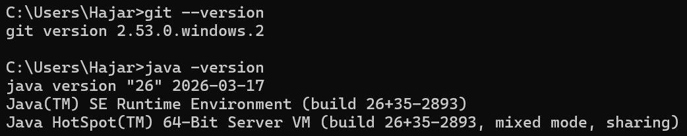
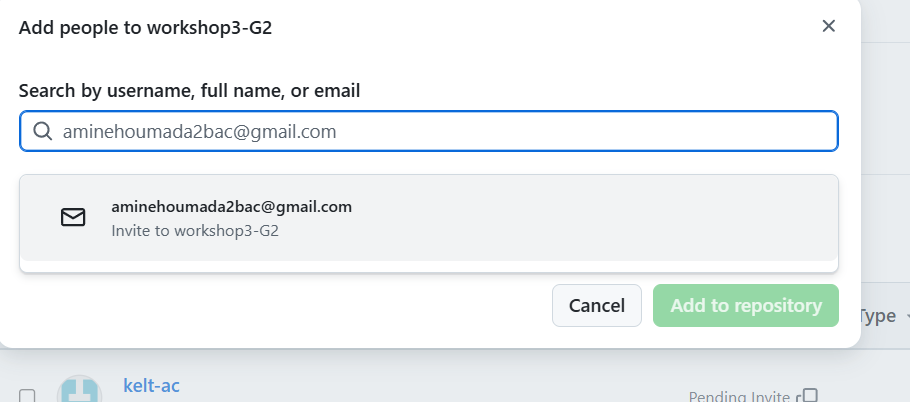
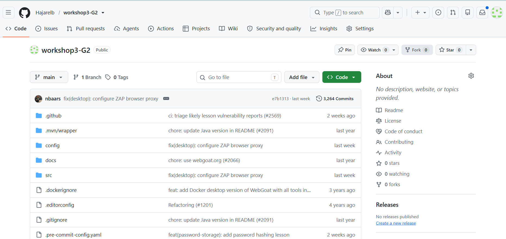

# Workshop 3 : Sécurité des dépendances (SCA)
**Dependabot & OWASP Dependency-Check**

- **Module** : DevSecOps, Master DevOps et Cloud Computing
- **Université** : Abdelmalek Essaâdi, FP Larache
- **Groupe** : G2
- **Membres** :
  - Hajar EL BACHIRI
  - Keltouma ACHGUER
  - Mohamed El Amine HOUMADA
- **Projet analysé** : [WebGoat](https://github.com/WebGoat/WebGoat), application Java/Maven volontairement vulnérable (OWASP)

## 1. Objectif

Sécuriser les dépendances d'un projet Maven en utilisant :
- **Dependabot** : détection des dépendances vulnérables et mises à jour automatiques via des Pull Requests.
- **OWASP Dependency-Check** : analyse SCA qui compare les dépendances à la base NVD pour détecter les CVE.

Ces outils s'intègrent dans un pipeline CI/CD (GitHub Actions) pour appliquer le principe du *Shift Left*.

## 2. Définitions

| Terme | Définition |
|---|---|
| Dépendance | Bibliothèque externe utilisée par le projet, déclarée dans `pom.xml` |
| CVE | Identifiant public d'une faille de sécurité connue |
| CVSS | Score de gravité d'une CVE, de 0 à 10 |
| SCA | Software Composition Analysis : analyse des composants tiers |
| Dependabot | Outil GitHub qui alerte et propose des mises à jour de dépendances |
| OWASP Dependency-Check | Outil SCA qui détecte les dépendances ayant des CVE connues |
| Pull Request (PR) | Proposition de modification à relire avant fusion dans la branche principale |

## 3. Environnement de travail

Outils utilisés :
- Git, GitHub (dépôt + GitHub Actions)
- JDK (version : 26) et Maven Wrapper (`mvnw`) fourni par WebGoat
- Éditeur : Visual Studio Code

## 4. Mise en place du dépôt

Le dépôt `workshop3-G2` a été créé vide sur GitHub, puis alimenté avec le code de WebGoat (clone, changement de remote, push).

