# Workshop 3 : Sécurité des dépendances (SCA)

**Dependabot & OWASP Dependency-Check**

- **Module** : DevSecOps, Master DevOps et Cloud Computing
- **Université** : Abdelmalek Essaâdi, FP Larache
- **Groupe** : G2
- **Membres** :
  - Hajar EL BACHIRI
  - Keltouma ACHGUER
  - Mohamed El Amine HOUMADA
- **Projet analysé** : [WebGoat](https://github.com/WebGoat/WebGoat), application Java/Maven volontairement vulnérable (OWASP)

## 1. Objectif

Sécuriser les dépendances d'un projet Maven en utilisant :
- **Dependabot** : détection des dépendances vulnérables et mises à jour automatiques via des Pull Requests.
- **OWASP Dependency-Check** : analyse SCA qui compare les dépendances à la base NVD pour détecter les CVE.

Ces outils s'intègrent dans un pipeline CI/CD (GitHub Actions) pour appliquer le principe du *Shift Left*.

## 2. Définitions

|         Terme          |                                  Définition                                  |
|------------------------|------------------------------------------------------------------------------|
| Dépendance             | Bibliothèque externe utilisée par le projet, déclarée dans `pom.xml`         |
| CVE                    | Identifiant public d'une faille de sécurité connue                           |
| CVSS                   | Score de gravité d'une CVE, de 0 à 10                                        |
| SCA                    | Software Composition Analysis : analyse des composants tiers                 |
| Dependabot             | Outil GitHub qui alerte et propose des mises à jour de dépendances           |
| OWASP Dependency-Check | Outil SCA qui détecte les dépendances ayant des CVE connues                  |
| Pull Request (PR)      | Proposition de modification à relire avant fusion dans la branche principale |

## 3. Environnement de travail

Outils utilisés :
- Git, GitHub (dépôt + GitHub Actions)
- Java 25 (version requise par WebGoat), installé automatiquement par le workflow GitHub Actions
- Éditeur : Visual Studio Code


## 4. Mise en place du dépôt

Le dépôt `workshop3-G2` a été créé vide sur GitHub, puis alimenté avec le code de WebGoat (clone, changement de remote, push).


## 5. Pipeline hérité de WebGoat et problème rencontré

WebGoat fournit déjà des workflows GitHub Actions (`.github/workflows/build.yml`, etc.) et un fichier `.github/dependabot.yml`. Ils s'exécutent automatiquement à chaque push.

À notre premier push, le job **Pre-commit check** a échoué : l'outil **Spotless** contrôle aussi le formatage des fichiers Markdown et notre `README.md` n'était pas conforme. Le job **build** a alors été ignoré (*skipped*).

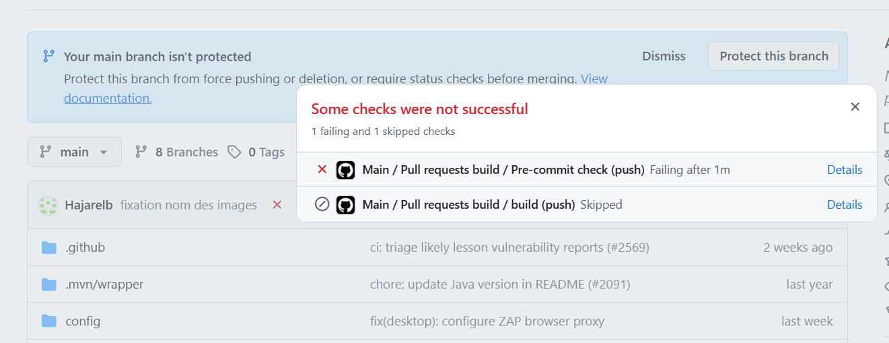

Correction : nous avons lancé `mvn spotless:apply` en local, qui a reformaté le README, puis poussé le résultat. Le pipeline passe au vert : le projet compile sans erreur avec Java 25.

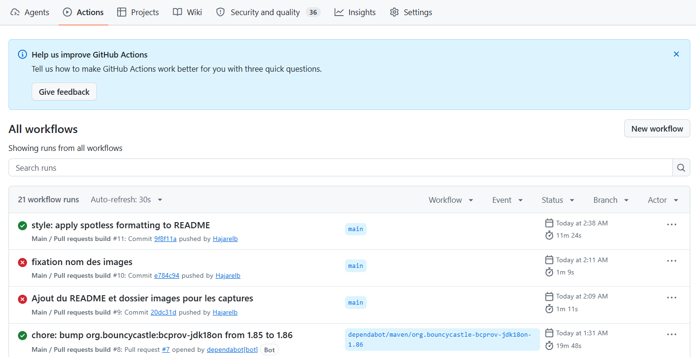

> Règle retenue : avant chaque push qui modifie le README, exécuter `mvn spotless:apply`.

## 6. Dependabot : configuration d'origine

Le projet WebGoat contenait **déjà** un fichier `.github/dependabot.yml`. Avant de le modifier, nous l'avons analysé pour comprendre son fonctionnement.

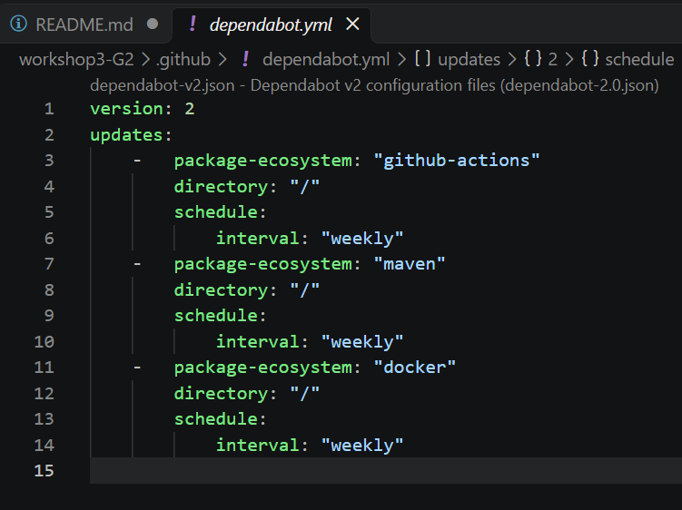

|      Paramètre      |                              Rôle                              |
|---------------------|----------------------------------------------------------------|
| `version: 2`        | Version du format de configuration                             |
| `package-ecosystem` | Type de dépendances à surveiller                               |
| `directory`         | Dossier où se trouve le fichier de dépendances (`/` = racine)  |
| `schedule.interval` | Fréquence de vérification (ici `weekly`, une fois par semaine) |

Trois écosystèmes sont surveillés :

|    Écosystème    |           Ce qui est surveillé           |
|------------------|------------------------------------------|
| `maven`          | Les dépendances Java du `pom.xml`        |
| `github-actions` | Les actions utilisées dans les workflows |
| `docker`         | L'image de base du `Dockerfile`          |

Cette configuration était déjà active : elle a généré les alertes et les Pull Requests présentées dans les sections suivantes.

## 7. Dependabot Alerts : état initial

Nous avons activé **Dependency graph** et **Dependabot alerts** dans *Settings → Advanced Security*. GitHub détecte **36 alertes** (de gravité High et Moderate) dans les dépendances du projet.

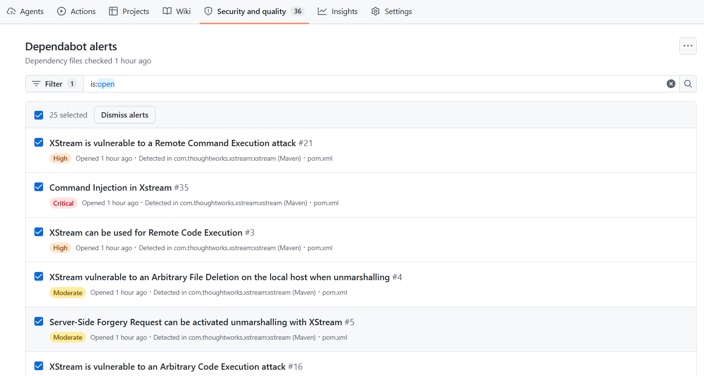

## 8. Pull Requests de Dependabot

Grâce au `dependabot.yml` existant, Dependabot a ouvert **7 PRs** de mise à jour. Chacune comporte une description et déclenche les vérifications du pipeline.

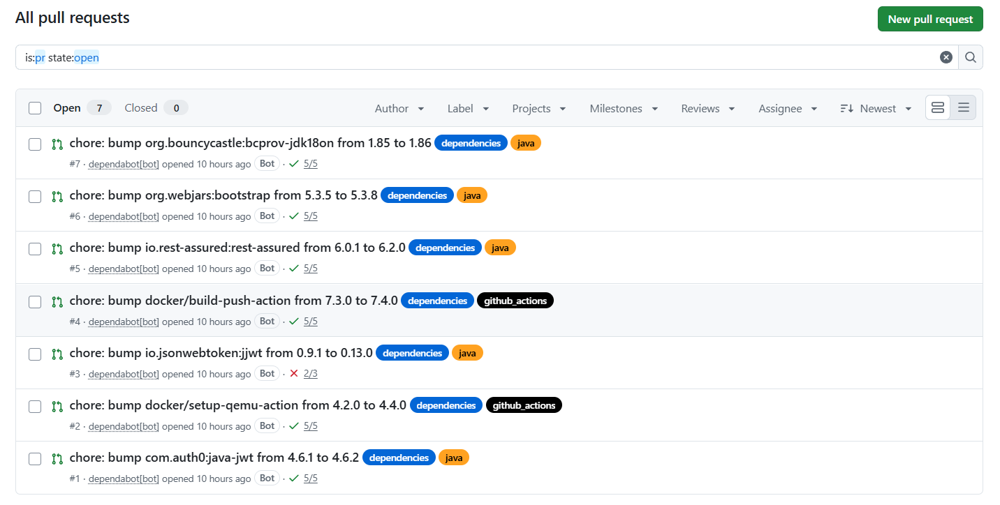

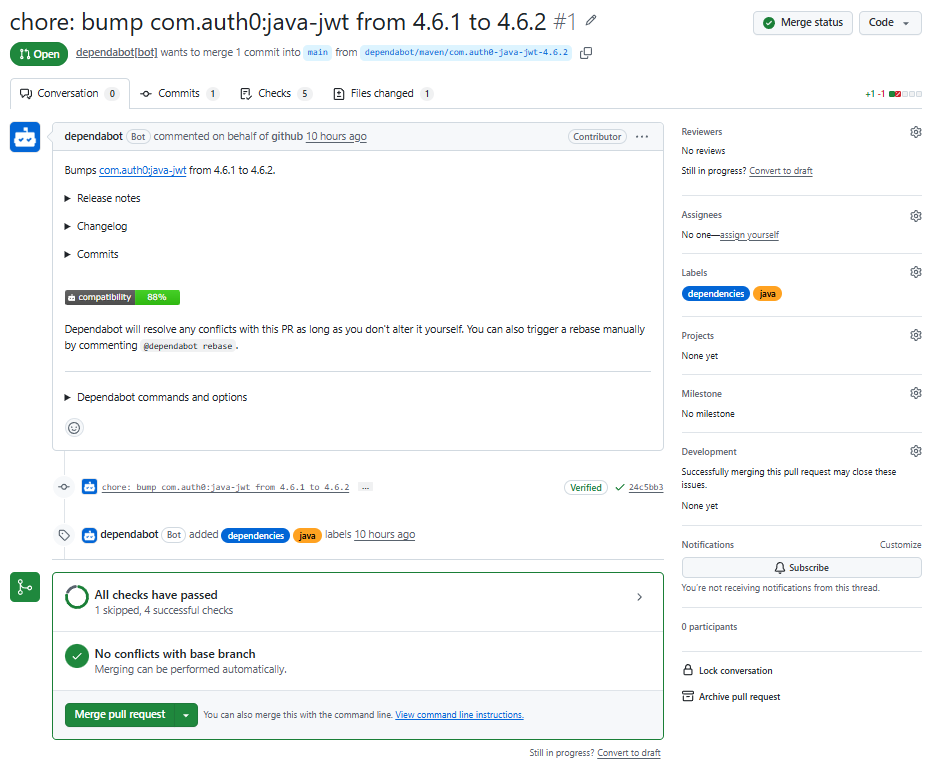

### Analyse

| PR |               Mise à jour                | Vérifications |   Décision    |
|----|------------------------------------------|---------------|---------------|
| #1 | `java-jwt` 4.6.1 → 4.6.2                 | OK            | Fusionnée     |
| #2 | `docker/setup-qemu-action` 4.2.0 → 4.4.0 | OK            | Fusionnée     |
| #3 | `jjwt` 0.9.1 → 0.13.0                    | **Échec**     | Non fusionnée |
| #4 | `docker/build-push-action` 7.3.0 → 7.4.0 | OK            | Fusionnée     |
| #5 | `rest-assured` 6.0.1 → 6.2.0             | OK            | Fusionnée     |
| #6 | `bootstrap` 5.3.5 → 5.3.8                | OK            | Fusionnée     |
| #7 | `bcprov-jdk18on` 1.85 → 1.86             | OK            | Fusionnée     |

La PR #3 est une mise à jour **majeure** (0.9.1 → 0.13.0) : l'API de la bibliothèque a changé et le pipeline échoue. Elle nécessite une adaptation du code et n'a donc pas été fusionnée automatiquement.

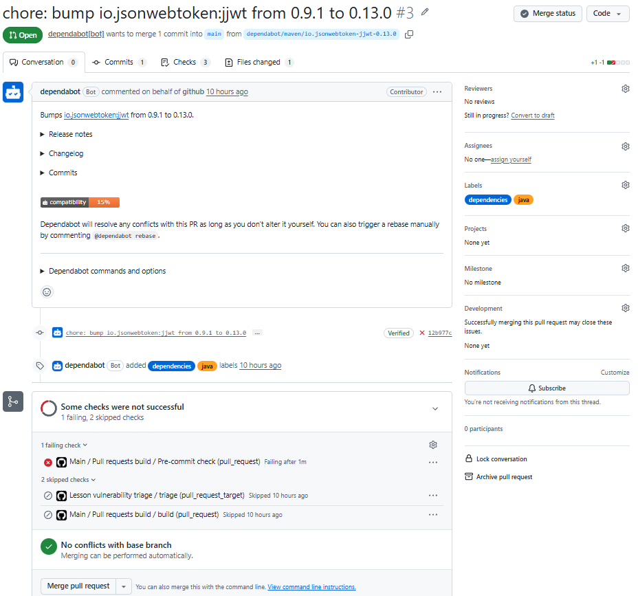

Les autres PRs, validées par le pipeline, ont été fusionnées une par une.

Après la fusion de la PR #6, la PR #7 a présenté un **conflit** sur le `pom.xml` : les deux PRs modifient des lignes voisines (versions de `bootstrap` et de `bouncycastle`).

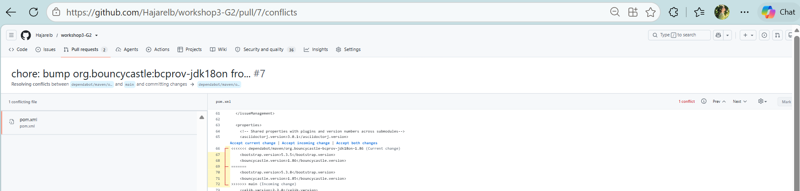

Pour le résoudre, nous avons commenté `@dependabot rebase` dans la PR. Dependabot a recalculé la branche à partir du `main` à jour (`force-push`), ce qui a supprimé le conflit et relancé les vérifications du pipeline. GitHub affiche alors **No conflicts with base branch**.

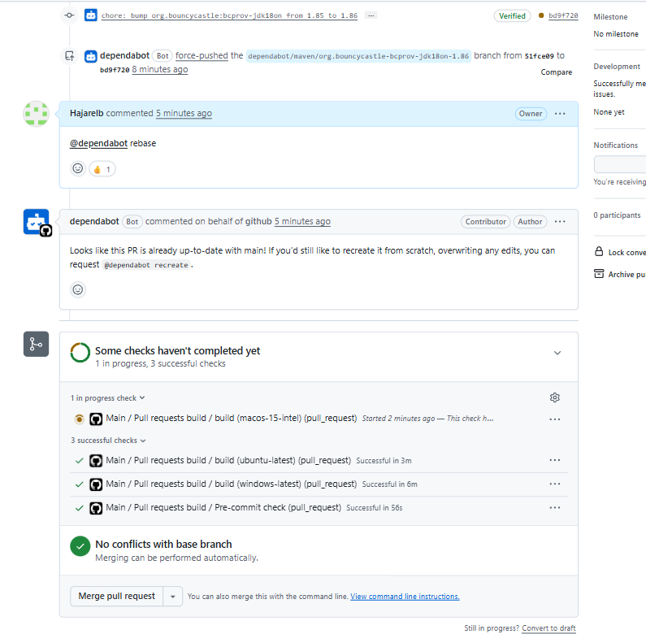

Une fois les vérifications au vert, la PR a été fusionnée.

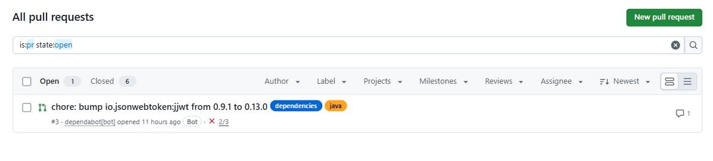

## 9. Résultat après fusion

Après les fusions, le nombre d'alertes Dependabot **n'a pas changé** : il reste de **36** alertes ouvertes (0 fermée).

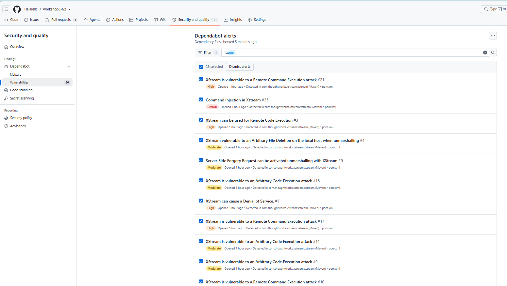

Les alertes portent uniquement sur la bibliothèque **XStream** (exécution de code à distance, injection de commandes, déni de service, SSRF), qu'aucune des PRs fusionnées ne mettait à jour.

Les PRs de *version updates* maintiennent les dépendances à jour, mais ne ciblent pas spécifiquement les dépendances vulnérables. Pour cela, il faut activer les **Dependabot security updates** (voir section 10).

## 10. Dependabot security updates et cas de XStream

Les **Dependabot alerts** servent seulement à prévenir : elles n'ouvrent aucune PR. Pour obtenir des PRs de correction, il faut activer les **Dependabot security updates** (*Settings → Advanced Security*), ce que nous avons fait. C'est pourquoi la PR sur XStream n'est apparue qu'après cette activation.


### Origine des alertes

Les 36 alertes portent sur une seule bibliothèque : **XStream**, déclarée en version **1.4.5** (très ancienne) dans le `pom.xml`.

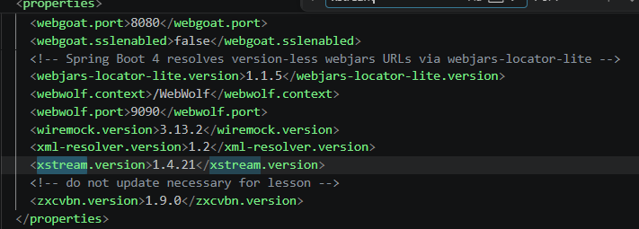

### PR générée

Après l'activation, Dependabot a ouvert la **PR #8** : mise à jour de XStream de **1.4.5 à 1.4.21**. GitHub indique que sa fusion résoudrait les alertes, dont une **critique**.

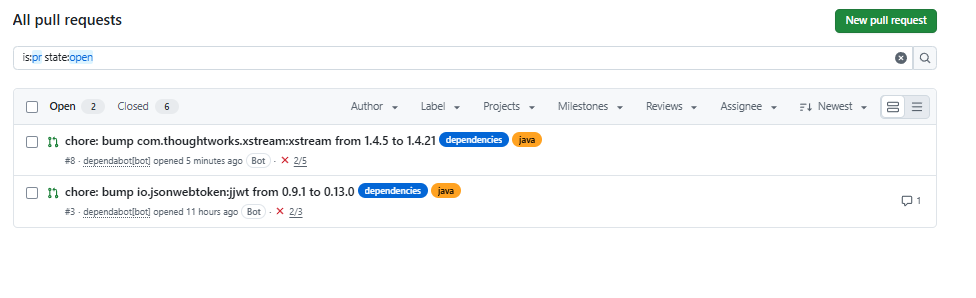

Le job **build** échoue :

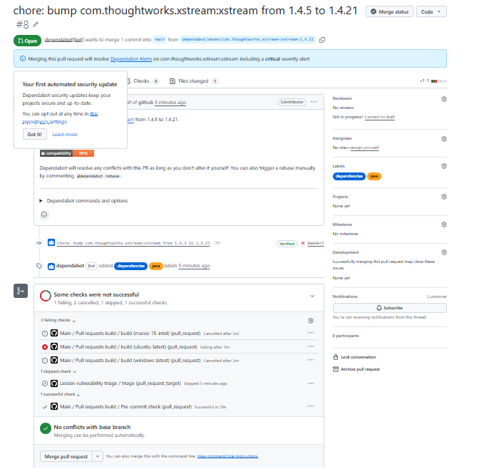

Sur 398 tests, un seul échoue : `VulnerableComponentsLessonTest`, avec l'erreur `ForbiddenClass ... ContactImpl`. Dependabot ne modifie que le numéro de version, jamais le code Java : c'est à nous d'adapter le code.

## 11. Correction du code

La leçon *Vulnerable Components* de WebGoat est un exercice qui exploite volontairement XStream 1.4.5, qui accepte n'importe quelle classe lors de la désérialisation XML. Les versions récentes de XStream **refusent par défaut** toute classe non autorisée, même `ContactImpl`, qui est légitime.

Correction : une **liste blanche** qui autorise uniquement `ContactImpl`. Toute autre classe, comme celles du code d'attaque (`ProcessBuilder`), reste refusée. Cette ligne a été ajoutée dans la leçon et dans le test :

```java
xstream.alias("contact", ContactImpl.class);
xstream.allowTypes(new Class[] {ContactImpl.class}); // ligne ajoutée
xstream.ignoreUnknownElements();
```

| Fichier | Modification |
|---|---|
| `VulnerableComponentsLesson.java` | ajout de `allowTypes` après `alias` |
| `VulnerableComponentsLessonTest.java` | même ajout dans `testTransformation` |

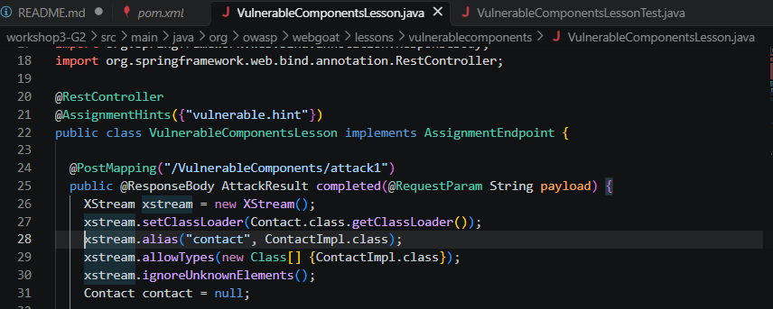

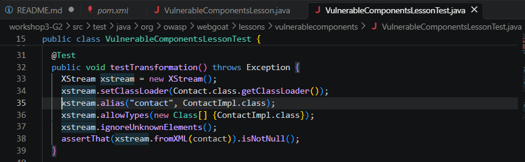

Nous avons poussé la correction sur la branche de la PR. La PR s'est mise à jour automatiquement et le pipeline a été relancé :

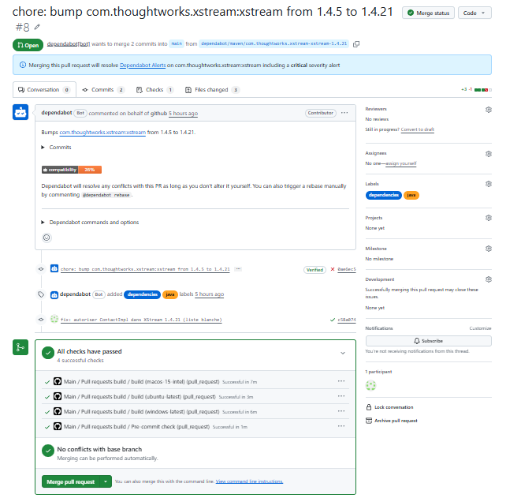

Les checks sont passés au vert, puis la PR a été fusionnée.

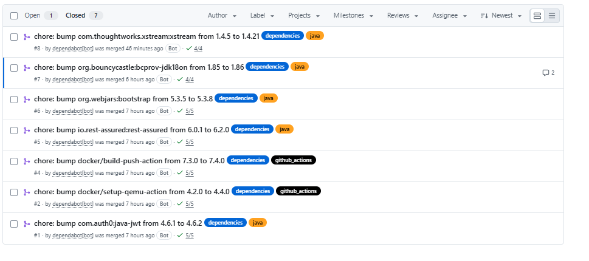

Le pipeline sur `main` reste vert : le projet compile et les 398 tests passent.

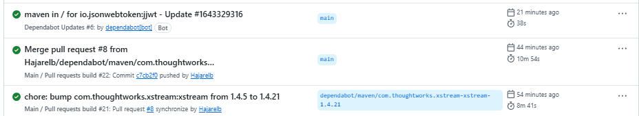

## 12. Résultat final

Après la fusion, les **36 alertes** ont été fermées : le compteur **Open** est passé de **36 à 0**.

|      | Avant | Après |
|---|---|---|
| Alertes Dependabot ouvertes | 36 | 0 |
| XStream | 1.4.5 | 1.4.21 |

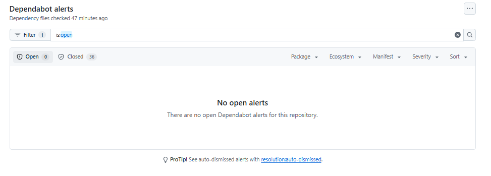

> **Compromis** : la liste blanche empêche l'exploitation de la leçon *Vulnerable Components* telle qu'elle est conçue (injection d'un objet malveillant dans XStream). C'est précisément l'effet recherché d'une correction de sécurité, mais l'exercice pédagogique ne peut plus être résolu comme prévu.